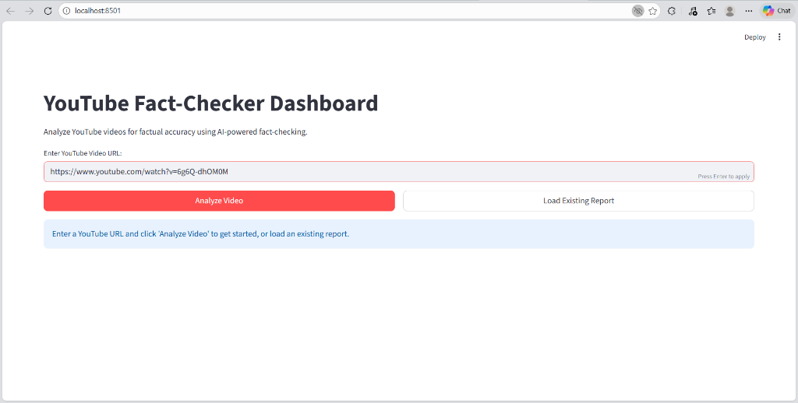
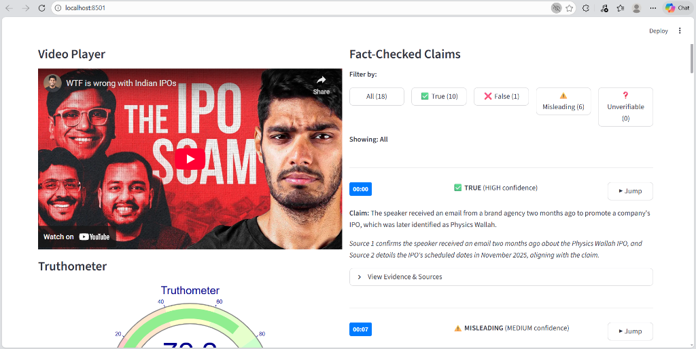
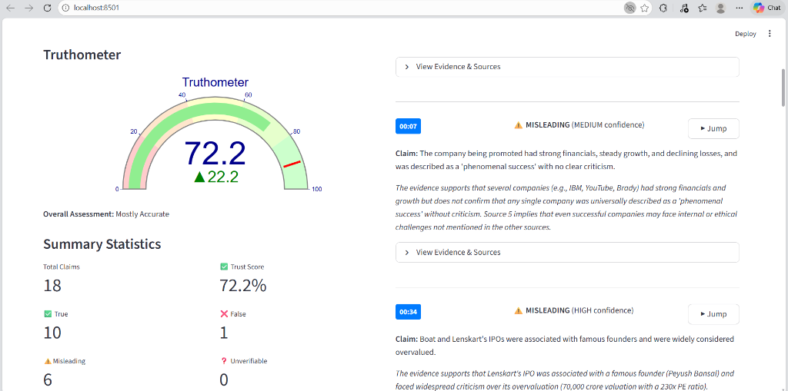
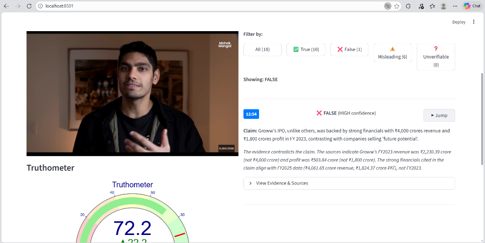
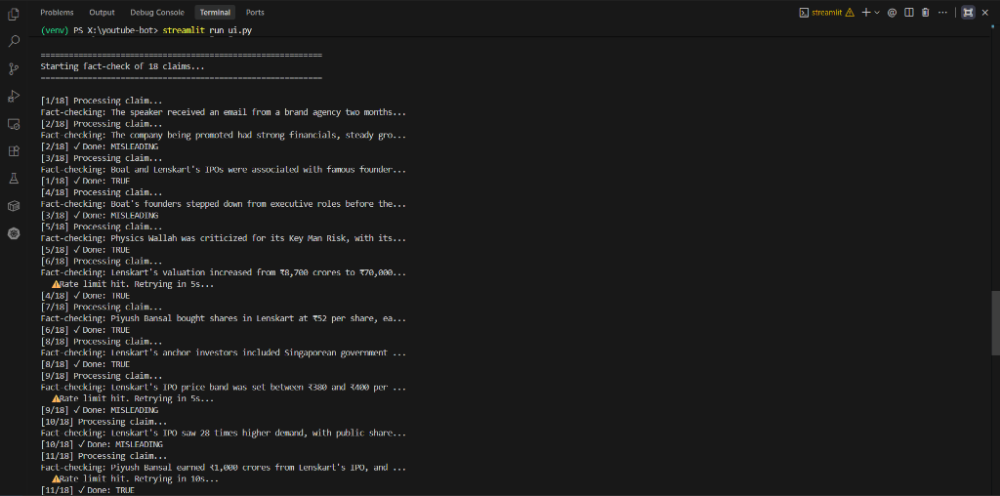

# YouTube Fact-Checker Bot 🤖✅

A Python-based AI tool that automatically extracts claims from YouTube video transcripts and fact-checks them using a multi-agent system (Tavily for research, Groq LLM for judgment).



## 📸 Screenshots

| Video Player & Sync | Truthometer Analytics |
|:-------------------:|:---------------------:|
|  |  |
| **Interactive Claims** | **Deep Dive Reports** |
|  |  |

---

## 🏗️ Technical Architecture

The application is built on a **3-Phase Fact-Checking Pipeline** orchestrated by Python, with a Streamlit frontend.

### 1. The Fact-Checking Pipeline (Backend)
Located in `fact_checker.py`, the system uses a **Teacher-Judge-Packager** architecture (simplified to Research-Judge here):

#### **Phase 1: Research (The "Researcher")**
- **Tool**: [Tavily API](https://tavily.com/)
- **Logic**: We use Tavily's `search_depth="advanced"` mode to perform deep web scrapes for each claim.
- **Process**:
  1. Receives a claim string (e.g., "Python was released in 1991").
  2. Tavily searches trusted domains and returns up to 5 relevant text snippets with URLs.
  3. **Error Handling**: If the API fails or returns no results, the system flags the claim as `UNVERIFIABLE` to prevent hallucinations.

#### **Phase 2: Judgment (The "Judge")** ⚖️
- **Tool**: [Groq API](https://groq.com/) (running Llama 3 / Mixtral / Qwen)
- **Prompt Engineering**: The system uses a strict "Chain of Thought" prompt.
  - **Input**: The original claim + raw evidence snippets from Tavily.
  - **Instruction**: "Based ONLY on the evidence provided above..."
  - **Output**: A strict JSON object containing:
    - `verdict`: TRUE | FALSE | MISLEADING | UNVERIFIABLE
    - `confidence`: HIGH | MEDIUM | LOW
    - `explanation`: A concise summary of *why* the verdict was reached.
- **Resiliency**: The system includes a **regex fallback parser** (`re.search(r'\{.*\}', content)`) to handle cases where the LLM wraps the JSON in markdown or adds conversational filler.

#### **Phase 3: Packaging**
- Aggregates the `timestamp`, `claim`, `verdict`, and `evidence` into a structured JSON report (`fact_checked_report.json`).

### 2. The Interactive Dashboard (Frontend)
Built with **Streamlit**, the UI handles the complex synchronization between video playback and data.

#### **Video Synchronization Logic** 🔄
- **Problem**: Streamlit reruns the entire script on every interaction, which usually resets video players.
- **Solution**:
  - We use **Session State** (`st.session_state['timestamp']`) to track the current seek time.
  - When you click "▶ Jump" on a claim card:
    ```python
    # From ui.py
    if st.button("▶ Jump", key=f"jump_{index}"):
        st.session_state['timestamp'] = seconds  # Update state
        st.rerun()  # Force reload
    ```
  - The iframe URL is dynamically rebuilt with the `start` parameter: `https://www.youtube.com/embed/{video_id}?start={timestamp}`.

#### **The "Truthometer" Logic** 📊
- **Visual**: A custom `plotly.graph_objects.Indicator` gauge chart.
- **Algorithm**: A weighted formula to calculate the "Trust Score" (0-100%):
  $$ \text{Score} = \left( \frac{\text{Count}_{\text{True}} + 0.5 \times \text{Count}_{\text{Misleading}}}{\text{Total Claims}} \right) \times 100 $$
- **Reasoning**:
  - **True claims** give full points.
  - **Misleading claims** give half points (they have grains of truth but lack context).
  - **False/Unverifiable** give zero points.

---

## 🚀 Setup & Installation

1. **Clone & Install**
   ```bash
   git clone https://github.com/yourusername/youtube-bot.git
   cd youtube-bot
   pip install -r requirements.txt
   ```
   *(Ensure you have `streamlit`, `tavily-python`, `langchain-groq`, `youtube-transcript-api` installed)*

2. **Configure API Keys**
   Create a `.env` file:
   ```env
   GROQ_API_KEY=gsk_...
   TAVILY_API_KEY=tvly-...
   ```

3. **Run the Dashboard**
   ```bash
   streamlit run ui.py
   ```

## 🔧 Usage Guide

1. **Enter URL**: Paste a YouTube link in the input field.
2. **Analyze**: Click "Analyze Video". The system will:
   - Fetch the transcript (supports English, Hindi, and Hinglish).
   - Extract claims using the LLM.
   - Run the 3-phase fact-check loop.
3. **Explore Results**:
   - **Filter**: Click the pills to see only "FALSE" or "MISLEADING" claims.
   - **Verify**: Click "View Evidence" on any card to see the actual source URLs found by Tavily.

---

## 📂 File Structure

- `ui.py`: Main Streamlit application (Frontend).
- `fact_checker.py`: Core logic for Research (Tavily) and Judgment (Groq).
- `main.py`: CLI entry point and orchestration.
- `transcript.txt`: Temporary storage for raw video text.
- `report.json`: Final structured output.
